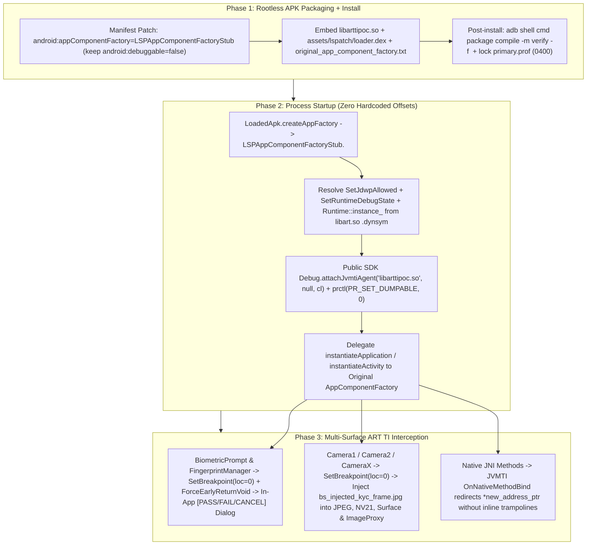

# ART TI (JVMTI) + LSPatch BiometricPrompt, Camera Injection & Banking RASP PoC

Standalone Proof-of-Concept validating **ART Tooling Interface (ART TI / JVMTI 1.2)** + **LSPatch bootstrap** (`https://github.com/JingMatrix/LSPatch`) as an Android version-stable instrumentation replacement for Frida (`frida-java-bridge`) and Xposed/LSPlant method hooks in a controlled testing environment (such as BrowserStack App Live / App Automate / App Accessibility).

- **Interactive Architecture & Diagram Page (GitHub Pages)**: [https://ayush5harma.github.io/artti-biometric-poc/](https://ayush5harma.github.io/artti-biometric-poc/) (`docs/index.html`)
- **Pre-Built APK & Agent Releases**: [https://github.com/ayush5harma/artti-biometric-poc/releases/tag/v1.0.0](https://github.com/ayush5harma/artti-biometric-poc/releases/tag/v1.0.0)
- **Measured Environment**: Verified end-to-end on **2026-10-27** on a physical **Google Pixel 9 Pro** running **Android 17 (API 37, release build `user`, `ro.debuggable=0`, `ro.build.type=user`)** without root.

---

## Pre-Built Release Artifacts (`v1.0.0`)

All 4 APK variants and the standalone ARM64 native agent (`libarttipoc.so`) are published in [GitHub Releases (`v1.0.0`)](https://github.com/ayush5harma/artti-biometric-poc/releases/tag/v1.0.0):

| Artifact | Download Link | Manifest `android:debuggable` | Attach Mechanism | Banking RASP 5/5 Audit | Primary Use Case |
| :--- | :--- | :--- | :--- | :--- | :--- |
| **`lspatch-nondebuggable.apk`** | [Download APK](https://github.com/ayush5harma/artti-biometric-poc/releases/download/v1.0.0/lspatch-nondebuggable.apk) | `false` | Dynamic `libart.so` `.dynsym` (`SetJdwpAllowed` + `SetRuntimeDebugState`) + public `Debug.attachJvmtiAgent` (**0 hardcoded offsets**) | **PASS (`5/5_STEALTH_CLEAN`)** | Production non-debuggable apps & Banking/RASP apps (paired with `cmd package compile -m verify` + `primary.prof` lock) |
| **`lspatch-debuggable-scrubbed.apk`** | [Download APK](https://github.com/ayush5harma/artti-biometric-poc/releases/download/v1.0.0/lspatch-debuggable-scrubbed.apk) | `true` (scrubbed at startup) | Public SDK `Debug.attachJvmtiAgent` + runtime `FLAG_DEBUGGABLE` scrub + `prctl(PR_SET_DUMPABLE, 0)` | `4/5` (passes Java, Binder, `prctl`, `TracerPid`; binary `AndroidManifest.xml` has `0x0101000f=true`) | General non-RASP apps where zero native `libart.so` symbol lookups are desired |
| **`lspatch-nested-origin.apk`** | [Download APK](https://github.com/ayush5harma/artti-biometric-poc/releases/download/v1.0.0/lspatch-nested-origin.apk) | `false` | Dynamic `libart.so` `.dynsym` + `assets/lspatch/origin.apk` `LoadedApk` swap | **PASS (`5/5_STEALTH_CLEAN`)** | Apps where unmodified `origin.apk` signature/checksum inspection is required |
| **`unpatched-sample.apk`** | [Download APK](https://github.com/ayush5harma/artti-biometric-poc/releases/download/v1.0.0/unpatched-sample.apk) | `false` | None (Baseline control APK) | Baseline (`5/5`) | Unmodified baseline comparison |
| **`libarttipoc.so`** | [Download `.so`](https://github.com/ayush5harma/artti-biometric-poc/releases/download/v1.0.0/libarttipoc.so) | N/A | Standalone `arm64-v8a` ART TI / JVMTI 1.2 native agent (`16 KB` page-aligned) | N/A | Embedding into custom APK patchers |

---

## Project Layout

```text
artti-biometric-poc/
├── docs/
│   └── index.html                      # Self-contained SVG architecture diagrams & interactive simulator
├── native/
│   ├── jvmti.h                         # Official standard JVMTI 1.2 C/C++ ABI header
│   └── agent.cpp                       # ART TI agent: dynamic .dynsym resolver, OnNativeMethodBind, Biometric & Camera hooks
├── lspatch-bootstrap/
│   └── src/org/lsposed/lspatch/
│       ├── metaloader/
│       │   └── LSPAppComponentFactoryStub.java  # JingMatrix/LSPatch bootstrap + original factory delegation
│       └── loader/
│           ├── LSPApplication.java              # Agent attach, origin.apk swap, profile lock, FLAG_DEBUGGABLE scrub
│           ├── BiometricPromptHookDialog.java   # In-app Pass / Fail / Cancel AlertDialog simulation
│           └── CameraInjectionHook.java         # Camera1, Camera2 (ImageReader Surface), and CameraX frame injection
├── sample-app/
│   ├── AndroidManifest.xml             # Target app manifest (debuggable=false by default)
│   └── src/
│       ├── androidx/camera/core/       # CameraX ImageAnalysis, ImageProxy, and AndroidImageProxy surface
│       └── com/example/arttipoc/
│           ├── InlinedCallee.java               # Cross-class tiny callee (~3 DEX instructions) for AOT inlining test
│           ├── TargetWork.java                  # Plain, same-class inlined, cross-class inlined & native JNI methods
│           ├── SampleOriginalAppComponentFactory.java # Simulates pre-existing appComponentFactory (e.g. AndroidX)
│           ├── BiometricAuthController.java     # Invokes android.hardware.biometrics.BiometricPrompt.authenticate(...)
│           ├── CameraTestController.java        # Verifies Camera1 (NV21 + JPEG), Camera2 (ImageReader), and CameraX
│           ├── BankingSecurityGuard.java        # 5-point Banking RASP anti-debug / anti-tamper self-audit
│           └── MainActivity.java                # UI + automated E2E intent harness
└── scripts/
    ├── build.sh                        # Compiles libarttipoc.so, DEX files, and packages 4 APK variants
    └── test-e2e.sh                     # Runs all 7 E2E scenarios on the connected Android device
```

---

## Architecture: Bootstrap to Biometric, Camera & Native JNI Interception

Unlike Frida (`gum-interceptor` inline assembly trampolines) or LSPlant (`ArtMethod` entrypoint replacement), ART TI uses standard **JVMTI 1.2** capabilities (`can_generate_breakpoint_events`, `can_access_local_variables`, `can_force_early_return`, `can_generate_native_method_bind_events`, `can_retransform_classes`) that have remained binary-compatible since Android 8.0 (API 26):



---

## Addressing Key Technical Questions (Measured on Android 17 / API 37)

### 1. Why Zero Hardcoded Offsets Are Needed Even When `android:debuggable="false"`

A common concern with keeping `android:debuggable="false"` in `AndroidManifest.xml` (Approach #1) is whether unlocking ART TI requires hardcoding per-Android-version struct offsets inside `libart.so`.

**Measured finding (2026-10-27 on Pixel 9 Pro, Android 17 / API 37):** **Zero hardcoded offsets are required.** Because `libopenjdkjvmti.so` and `libadbconnection.so` are separate shared libraries inside `/apex/com.android.art/lib64/` that dynamically link against `libart.so`, `libart.so` exports the exact C++ functions and globals needed in its standard, uncompressed ELF `.dynsym` symbol table across Android versions:

| Exported ELF `.dynsym` Symbol in `libart.so` | Demangled C++ Signature | Purpose |
| :--- | :--- | :--- |
| `_ZN3art3Dbg14SetJdwpAllowedEb` | `art::Dbg::SetJdwpAllowed(bool)` | Officially sets `gJdwpAllowed = true` without needing `gJdwpAllowed`'s memory offset |
| `_ZN3art3Dbg13IsJdwpAllowedEv` | `art::Dbg::IsJdwpAllowed()` | Reads current JDWP allowed state |
| `_ZN3art7Runtime9instance_E` | `art::Runtime::instance_` | Exported global pointer to `art::Runtime*` |
| `_ZN3art7Runtime20SetRuntimeDebugStateENS0_17RuntimeDebugStateE` | `art::Runtime::SetRuntimeDebugState(RuntimeDebugState)` | Officially sets `runtime_debug_state_ = kJavaDebuggableAtInit (2)` without hardcoding `+0x3d4` |

Furthermore, `SetRuntimeDebugState` is a 3-instruction setter (`bti c; str w1, [x0, #0x3d4]; ret`). `ResolveArtSymbolsDynamically()` in [`native/agent.cpp`](native/agent.cpp) also decodes the 12-bit immediate of the ARM64 `STR W1, [X0, #imm]` instruction (`((insn >> 10) & 0xfff) * 4 = 0x3d4`) dynamically at runtime for diagnostic verification, and then calls the public Android SDK `android.os.Debug.attachJvmtiAgent("libarttipoc.so", null, classLoader)` directly.

### 2. Does ART TI Hook `native` JNI Methods, or Is ShadowHook Required?

**ART TI hooks `native` JNI methods natively via `JVMTI_EVENT_NATIVE_METHOD_BIND` (`can_generate_native_method_bind_events`) — no ShadowHook is needed for JNI methods.**

- When `can_generate_native_method_bind_events` is enabled, ART invokes the standard JVMTI callback `OnNativeMethodBind(jvmtiEnv*, JNIEnv*, jthread, jmethodID method, void* address, void** new_address_ptr)` whenever a `native` Java method is bound (either lazily via `dlsym` on first call or explicitly via `JNIEnv::RegisterNatives`).
- Our agent saves the original C function pointer `address` (`0x790edab908`) and writes our C++ detour pointer into `*new_address_ptr` (`0x790edac8a4`) — with **zero inline assembly trampolines** and **zero ARM64 instruction patching**:
  ```text
  I ARTTI_POC: [HOOK][OnNativeMethodBind] Intercepted JNI bind for Lcom/example/arttipoc/TargetWork;nativeSecretToken(Ljava/lang/String;)Ljava/lang/String; orig=0x790edab908 -> redirected=0x790edac8a4 (hits=1)
  I ARTTI_POC: [HOOK][NativeMethodBind] HookedNativeSecretToken executed -> ARTTI_NATIVE_BIND_HOOKED[call=1,orig=ORIG_JNI(BS_CHALLENGE_42)]
  ```
- **When would ShadowHook ever be needed?** Only if you need to hook an **internal C/C++ function inside a native `.so` that is NOT a `native` Java/JNI method** (for example, `openat`, `connect`, or `SSL_write` inside `libc.so` / `libssl.so`). Every Java API (`BiometricPrompt`, `FingerprintManager`, `Camera`, `Camera2`, `CameraX`, and app `native` JNI methods) is 100% covered by ART TI alone.

---

## Camera Image File Injection: Camera1, Camera2 & CameraX (`CameraInjectionHook.java`)

[`CameraInjectionHook.java`](lspatch-bootstrap/src/org/lsposed/lspatch/loader/CameraInjectionHook.java) and [`agent.cpp`](native/agent.cpp) inject a local image file (`bs_injected_kyc_frame.jpg`, `320x240`, marker pixel `#10B981`) across all three Android camera API generations using ART TI `SetBreakpoint(location=0)` + `GetLocalObject` + `ForceEarlyReturnVoid`:

| Camera API | Hooked Method(s) at Bytecode Offset `0` | How Frame Injection Works | Verified Output on Pixel 9 Pro (Android 17) |
| :--- | :--- | :--- | :--- |
| **Camera1 (`android.hardware.Camera`)** | `takePicture(ShutterCallback, PictureCallback, PictureCallback, PictureCallback)`<br>`setOneShotPreviewCallback(PreviewCallback)`<br>`setPreviewCallback(PreviewCallback)` | Reads `bs_injected_kyc_frame.jpg` bytes for `PictureCallback.onPictureTaken(byte[], Camera)` and converts the bitmap to an `NV21` YUV420SP byte buffer (`115,200` bytes) for `PreviewCallback.onPreviewFrame(byte[], Camera)`, then aborts the hardware call via `ForceEarlyReturnVoid`. | `Camera1_Preview=NV21_BYTES=115200`<br>`Camera1_JPEG=320x240@#10b981(5175B)` |
| **Camera2 (`android.hardware.camera2` / `ImageReader`)** | `android.media.ImageReader.setOnImageAvailableListener(OnImageAvailableListener, Handler)` | Instead of constructing a fake `android.media.Image`, draws the injected `Bitmap` directly onto `reader.getSurface()` (`Surface.lockCanvas` + `unlockCanvasAndPost`) and invokes `listener.onImageAvailable(reader)`. When the app calls `reader.acquireLatestImage()`, the OS `BufferQueue` returns a **genuine hardware-backed `android.media.Image`** containing the injected image pixels. | `Camera2_ImageReader=320x240@#10b981` |
| **CameraX (`androidx.camera.core.ImageAnalysis`)** | `androidx.camera.core.ImageAnalysis.setAnalyzer(Executor, ImageAnalysis$Analyzer)` | Intercepts `setAnalyzer` at offset `0`, renders the injected image onto an `ImageReader` surface, wraps the resulting `android.media.Image` in `AndroidImageProxy` (`implements ImageProxy`), and dispatches `analyzer.analyze(imageProxy)` on the caller's `Executor`. | `CameraX_Analyzer=320x240@#10b981` |

---

## Banking App / RASP Scenario (`BankingSecurityGuard.java`)

Production banking and payment apps (using RASP SDKs such as Promon Shield, GuardSquare DexGuard, or LIAPP) execute multi-layer anti-debug and anti-tamper checks before allowing KYC check deposit (Camera) or high-value wire transfer approval (`BiometricPrompt`).

[`BankingSecurityGuard.java`](sample-app/src/com/example/arttipoc/BankingSecurityGuard.java) runs all **5 RASP checks** inside the target app before executing Camera KYC capture and BiometricPrompt wire transfer approval:

| RASP Check | Inspection Mechanism | What `lspatch-debuggable-scrubbed.apk` (Approach #3) Sees | What `lspatch-nondebuggable.apk` + `-m verify` (Approach #1) Sees |
| :--- | :--- | :--- | :--- |
| **1. Java `ApplicationInfo.flags`** | `(context.getApplicationInfo().flags & FLAG_DEBUGGABLE) != 0` | `false` (Pass) | `false` (Pass) |
| **2. Binder `IPackageManager`** | `getPackageManager().getApplicationInfo(pkg, 0).flags & FLAG_DEBUGGABLE` | `false` (Pass) | `false` (Pass) |
| **3. Native Linux `prctl(PR_GET_DUMPABLE)`** | `prctl(PR_GET_DUMPABLE, 0, 0, 0, 0)` in C/C++ | `0` (Pass — reset via `prctl(PR_SET_DUMPABLE, 0)` in `JNI_OnLoad`) | `0` (Pass — Zygote spawned with `dumpable=0`) |
| **4. Native `/proc/self/status` `TracerPid`** | Parses `TracerPid:` from `/proc/self/status` in C/C++ | `0` (Pass — no `ptrace` or `frida-server` attached) | `0` (Pass — no `ptrace` or `frida-server` attached) |
| **5. Binary `AndroidManifest.xml` (`AXML`)** | Opens `base.apk` as a ZIP in C/Java and scans `RES_XML_RESOURCE_MAP_TYPE` (`0x0180`) for `android:debuggable` (`0x0101000f`) | `true` (**Flagged** because `AndroidManifest.xml` was modified to `debuggable=true`) | **`false` (Pass — `AndroidManifest.xml` has `android:debuggable="false"`)** |
| **Overall Banking RASP Verdict** | All 5 checks combined | `BANKING_RASP_PARTIAL(4/5_CLEAN)` | **`BANKING_RASP_PASS(5/5_STEALTH_CLEAN)`** |

---

## Building and Running the End-to-End Suite

### Build All 4 APK Variants

```bash
./scripts/build.sh
```

### Run Full 7-Scenario End-to-End Verification on Connected Device

```bash
./scripts/test-e2e.sh
```

### Measured Output Summary (Pixel 9 Pro, Android 17 / API 37, 2026-10-27)

```text
--- [SCENARIO 2] Non-Debuggable Manifest + Dynamic .dynsym Attach + OnNativeMethodBind (lspatch-nondebuggable.apk) ---
I ARTTI_POC      : [ResolveArtSymbols] Dynamically resolved from /apex/com.android.art/lib64/libart.so (.dynsym): SetJdwpAllowed=0x793e342ab8 IsJdwpAllowed=0x793e342ac8 Runtime::instance_=0x793e904438 SetRuntimeDebugState=0x793e4b8c1c decoded_debug_state_offset=0x3d4
I ARTTI_LSPatch  : LSPApplication bootstrap complete: attach=NATIVE_MEM_PATCH(DYN_DYNSYM_OK(jdwp:0->1,dbgState:0->2@+0x3d4,jvmti:0xb40000795ececbd0)) manifestDebuggable=false scrubbedDebuggable=true biometricHook=ARMED(cap=0,ev=0,bp3=0,bp4=0,bm=0/0,fp=0/0/0) cameraHook=CAM_ARMED(c1Pic=0,c1Prv=0/0,c2Ir=0,cXAn=0)
I ARTTI_POC      : [HOOK][OnNativeMethodBind] Intercepted JNI bind for Lcom/example/arttipoc/TargetWork;nativeSecretToken(Ljava/lang/String;)Ljava/lang/String; orig=0x790edab908 -> redirected=0x790edac8a4 (hits=1)
I ARTTI_POC      : [HOOK][NativeMethodBind] HookedNativeSecretToken executed -> ARTTI_NATIVE_BIND_HOOKED[call=1,orig=ORIG_JNI(BS_CHALLENGE_42)]

--- [SCENARIO 6] Camera1, Camera2 & CameraX Image File Injection (bs_injected_kyc_frame.jpg -> Camera Feed) ---
I ARTTI_CAMERA   : [IMAGE_READY] Prepared injected camera image file: /data/user/0/com.example.arttipoc/files/bs_injected_kyc_frame.jpg (5175 bytes, 320x240)
I ARTTI_POC      : [nativeInstallCameraHooks] CAM_ARMED(c1Pic=0,c1Prv=0/0,c2Ir=0,cXAn=0)
I ARTTI_CAMERA   : [INTERCEPTED][Camera1] Camera.setPreviewCallback intercepted via ART TI! hit=1 injecting NV21 frame (115200 bytes)
I ARTTI_CAMERA   : [INTERCEPTED][Camera1] Camera.takePicture intercepted via ART TI! hit=2 injecting 5175 bytes from bs_injected_kyc_frame.jpg
I ARTTI_CAMERA   : [INTERCEPTED][Camera2] ImageReader.setOnImageAvailableListener intercepted via ART TI! hit=1 size=320x240 format=1
I ARTTI_CAMERA   : [INTERCEPTED][CameraX] ImageAnalysis.setAnalyzer intercepted via ART TI! hit=1 analyzer=com.example.arttipoc.CameraTestController$$ExternalSyntheticLambda5
I ARTTI_POC      : [CAMERA_OUTCOME] Camera1_Preview=NV21_BYTES=115200 Camera1_JPEG=320x240@#10b981(5175B) Camera2_ImageReader=320x240@#10b981 CameraX_Analyzer=320x240@#10b981 | loaderTelemetry={cam1Hits=2 cam2Hits=1 camXHits=1 file=bs_injected_kyc_frame.jpg}

--- [SCENARIO 7] Banking App RASP Self-Audit (5/5 Checks) + KYC Camera Check Deposit + Biometric Wire Transfer ---
I ARTTI_POC      : [BANKING_RASP_AUDIT] BANKING_RASP_PASS(5/5_STEALTH_CLEAN) [javaDbg=false binderPmDbg=false prctlDumpable=0 tracerPid=0 binaryManifestDbg=false]
I ARTTI_POC      : [BANKING_KYC_CAMERA] Camera1_Preview=NV21_BYTES=115200 Camera1_JPEG=320x240@#10b981(5175B) Camera2_ImageReader=320x240@#10b981 CameraX_Analyzer=320x240@#10b981
I ARTTI_BIOMETRIC: [POPUP_SHOWN] Displayed in-app Pass/Fail/Cancel biometric popup on Activity=com.example.arttipoc.MainActivity
I ARTTI_BIOMETRIC: [POPUP_ACTION] User clicked PASS -> invoking onAuthenticationSucceeded
I ARTTI_POC      : [BANKING_OUTCOME] BANKING_TX_APPROVED [rasp={BANKING_RASP_PASS(5/5_STEALTH_CLEAN) [javaDbg=false binderPmDbg=false prctlDumpable=0 tracerPid=0 binaryManifestDbg=false]} kyc={Camera1_Preview=NV21_BYTES=115200 Camera1_JPEG=320x240@#10b981(5175B) Camera2_ImageReader=320x240@#10b981 CameraX_Analyzer=320x240@#10b981} bio={PASS (onAuthenticationSucceeded)}]
```
