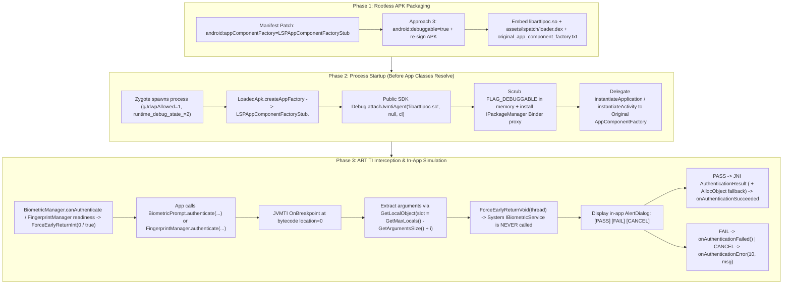

# ART TI (JVMTI) + LSPatch BiometricPrompt Simulation PoC

Standalone Proof-of-Concept validating **ART Tooling Interface (ART TI / JVMTI 1.2)** + **LSPatch bootstrap** (`https://github.com/JingMatrix/LSPatch`) as an Android version-stable instrumentation replacement for Frida (`frida-java-bridge`) and Xposed/LSPlant method hooks in a controlled testing environment (such as BrowserStack App Live / App Accessibility).

- **Interactive Architecture & Diagram Page (GitHub Pages)**: [https://ayush5harma.github.io/artti-biometric-poc/](https://ayush5harma.github.io/artti-biometric-poc/) (`docs/index.html`)
- **Measured Environment**: Verified end-to-end on **2026-10-26** on a physical **Google Pixel 9 Pro** running **Android 17 (API 37, release build `user`, `ro.debuggable=0`, `ro.build.type=user`)** without root.

---

## Project Layout

```text
artti-biometric-poc/
├── docs/
│   └── index.html                      # Self-contained SVG architecture diagrams & interactive popup simulator
├── native/
│   ├── jvmti.h                         # Official standard JVMTI 1.2 C/C++ ABI header
│   └── agent.cpp                       # ART TI agent + non-debuggable bypass + Biometric/Fingerprint hooks
├── lspatch-bootstrap/
│   └── src/org/lsposed/lspatch/
│       ├── metaloader/
│       │   └── LSPAppComponentFactoryStub.java  # JingMatrix/LSPatch bootstrap + original factory delegation
│       └── loader/
│           ├── LSPApplication.java              # Agent attach, origin.apk swap, profile lock, FLAG_DEBUGGABLE scrub
│           └── BiometricPromptHookDialog.java   # In-app Pass / Fail / Cancel AlertDialog simulation
├── sample-app/
│   ├── AndroidManifest.xml             # Target app manifest (debuggable=false by default)
│   └── src/com/example/arttipoc/
│       ├── InlinedCallee.java          # Cross-class tiny callee (~3 DEX instructions) for AOT inlining test
│       ├── TargetWork.java             # Plain, same-class inlined, and cross-class inlined methods
│       ├── SampleOriginalAppComponentFactory.java # Simulates pre-existing appComponentFactory (e.g. AndroidX)
│       ├── BiometricAuthController.java # Invokes android.hardware.biometrics.BiometricPrompt.authenticate(...)
│       └── MainActivity.java           # UI + automated E2E intent harness
└── scripts/
    ├── build.sh                        # Compiles libarttipoc.so, DEX files, and packages 4 APK variants
    └── test-e2e.sh                     # Runs all 5 E2E scenarios + Pass/Fail/Cancel + FingerprintManager tests
```

---

## Architecture: Bootstrap to `BiometricPrompt` Interception

Unlike Frida (`gum-interceptor` inline assembly trampolines) or LSPlant (`ArtMethod` entrypoint replacement), ART TI uses standard **JVMTI 1.2** capabilities that have remained binary-compatible since Android 8.0 (API 26):



### Why `GetMaxLocals() - GetArgumentsSize()` Is Required on Dalvik/ART

In JVM bytecode, method arguments occupy local variable slots starting at slot `0`. In Dalvik/ART register frames, local scratch registers occupy `v0 .. v[M - A - 1]` while incoming method parameters (`ins`, starting with `this` for instance methods) occupy the **highest** registers at the top of the frame (`v[M - A .. M - 1]`).

Measured on Android 17 (API 37) for `android.hardware.biometrics.BiometricPrompt`:
- `authenticate(CancellationSignal, Executor, AuthenticationCallback)V`: `GetMaxLocals() = 11`, `GetArgumentsSize() = 4` -> arguments live in `v7` (`this`), `v8` (`cancel`), `v9` (`executor`), `v10` (`callback`).
- `authenticate(CryptoObject, CancellationSignal, Executor, AuthenticationCallback)V`: `GetMaxLocals() = 14`, `GetArgumentsSize() = 5` -> arguments live in `v9` (`this`), `v10` (`crypto`), `v11` (`cancel`), `v12` (`executor`), `v13` (`callback`).

---

## Answering the Core PoC Questions (Measured on Android 17 / API 37)

### 1. Does `System.loadLibrary` Alone Let an ART TI Agent Attach in a Non-Debuggable App?

**No.** Calling `System.loadLibrary("arttipoc")` inside a non-debuggable app loads the ELF image and runs `JNI_OnLoad`, where `vm->GetEnv(..., JVMTI_VERSION_1_2)` fails with `JNI_EVERSION (-3)` because ART only registers the `JVMTI` `GetEnv` handler after `libopenjdkjvmti.so` is loaded via `Runtime::AttachAgent`.

Attempting to call `android.os.Debug.attachJvmtiAgent` or `VMDebug.attachAgent` in a `debuggable=false` process fails at **three gates** inside `libart.so` and `libopenjdkjvmti.so` (disassembled and measured from `/apex/com.android.art/lib64/libart.so` on Pixel 9 Pro, Android 17):

| Gate | Location | Check Performed | Measured Offset / Symbol on Android 17 (`arm64`) |
| :--- | :--- | :--- | :--- |
| **Gate 1** | `JavaVMExt::GetEnv` (`libart.so`) | Rejects `JVMTI_VERSION_*` and `kArtTiVersion (0x70010200)` until `libopenjdkjvmti.so` registers `GetEnvHandler` | Returns `JNI_EVERSION (-3)` |
| **Gate 2** | `Dbg::IsJdwpAllowed()` (`libart.so`) | `VMDebug_nativeAttachAgent` checks global boolean `gJdwpAllowed` before calling `Runtime::AttachAgent` | `_ZN3art3Dbg12gJdwpAllowedE` at `+0xe00004` |
| **Gate 3** | `Plugin::Load` (`libopenjdkjvmti.so`) | Calls `Runtime::IsJavaDebuggable()`, which reads `*(uint32_t*)(Runtime::instance_ + 0x3d4)` (`runtime_debug_state_`) and requires `>= 1` (`kJavaDebuggable` or `kJavaDebuggableAtInit`) | `_ZN3art7Runtime9instance_E` at `+0xe10438`, `runtime_debug_state_` at `+0x3d4` |

Furthermore, inside `ArtJvmTiEnv::SetCapabilities`, `CanReinitializeNeededClasses` checks `Runtime::IsJavaDebuggableAtInit()` (`runtime_debug_state_ == 2`) before granting `can_retransform_classes` across already-loaded classes, and `DeoptManager::FinishSetup()` resets `SetJavaDebuggable(true)` (`1`) during `Agent_OnAttach`.

### 2. Why Attaching in `LSPAppComponentFactoryStub.<clinit>` Solves App AOT Inlining

When the JVMTI agent is attached late (for example, inside `MainActivity.onCreate()`), `MainActivity` is already resolved and executing AOT machine code on the call stack, so `TargetWork.callerMethod()` inlined into `MainActivity` does not fire hooks unless called polymorphically or deoptimized.

When `LSPApplication.onLoad()` attaches the JVMTI agent inside `LSPAppComponentFactoryStub.<clinit>()` (during `LoadedApk.createAppFactory()`), `DeoptManager::FinishSetup()` transitions the ART runtime to debuggable (`UpdateEntrypointsForDebuggable`) **before `MainActivity` or any target app class is resolved by `ClassLinker`**. Consequently, even when `base.apk` is AOT-compiled with `cmd package compile -m speed`, all 3 method categories fire 100% of hooks on both direct and polymorphic calls:

- Plain method (`TargetWork.plainMethod`): `plain_entry=1`, `plain_bp=1`
- Same-class AOT-inlined method (`TargetWork.inlinedTarget`): `same_inlined_entry=1`, `same_inlined_bp=1`
- Cross-class AOT-inlined method (`InlinedCallee.crossClassInlined`): `cross_inlined_entry=1`, `cross_inlined_bp=1`
- `RetransformClasses` + `ClassFileLoadHook` (`mode=31`): `retransform_cap=0`, `cflh_ev=0`, `retransform_err=0`, `cflh_hits=2`

---

## Version Stability: Frida vs. LSPlant/LSPatch vs. ART TI (Approach 3)

| Dimension | Frida (`frida-java-bridge`) | LSPatch / LSPlant (Xposed) | ART TI + LSPatch Bootstrap (Approach 3) |
| :--- | :--- | :--- | :--- |
| **Method Hook Mechanism** | Patches `ArtMethod` entrypoints + inline ARM64 prolog trampolines | Synthesizes backup `ArtMethod` structs + replaces quick compiled entrypoints | Standard JVMTI 1.2 `SetBreakpoint(location=0)` + `ForceEarlyReturn*` |
| **Private `libart.so` Symbols Needed** | **15+ Mangled Symbols** (breaks when LLVM mangling or class layout changes) | **10+ Internal Symbols** (`ClassLinker`, `jit::JitCodeCache`, `art_quick_to_interpreter_bridge`) | **Zero (`0` Symbols)** — uses public SDK `Debug.attachJvmtiAgent` + standard `jvmtiEnv` |
| **Sensitivity to `ArtMethod` Struct Offsets** | **High** — hardcodes field offsets per Android API level | **High** — breaks whenever `ArtMethod` or `mirror::Class` layout shifts | **None** — Google maintains `libopenjdkjvmti.so` inside the `com.android.art` Mainline APEX |
| **ARM64 PAC / BTI Compatibility** | **Fragile** — inline code patching can trip Pointer Auth / BTI | **Moderate** — custom trampoline machine code per architecture | **Native** — no machine code patching; handled by ART runtime |
| **AOT Inlining Handling** | Manual deoptimization via internal `ClassLinker` | Fails if caller was AOT-inlined before hook installation | **Automatic** via `dex2oat --debuggable` + early attach in `<clinit>` + `RetransformClasses` |
| **Android 9 (API 28) -> Android 17 (API 37)+** | Requires per-release offset updates | Broken on Android 17 without `HiddenAPI` & symbol fixes | **CTS-Enforced Public SDK + JVMTI 1.2 ABI** |

---

## 4 Production Edge Cases Hardened & Verified

1. **Original `AppComponentFactory` Delegation (`LSPAppComponentFactoryStub.java`)**:
   - Real-world AndroidX / Hilt apps declare their own `android:appComponentFactory` (such as `androidx.core.app.CoreComponentFactory`).
   - `LSPAppComponentFactoryStub` reads `assets/lspatch/original_app_component_factory.txt` and delegates all 6 public `AppComponentFactory` lifecycle methods (`instantiateClassLoader`, `instantiateApplication`, `instantiateActivity`, `instantiateReceiver`, `instantiateService`, `instantiateProvider`) to an instance of the original factory (verified: `origFactoryDelegated=true`).
2. **Constructor-Free JNI `AllocObject` Fallback for `AuthenticationResult` (`agent.cpp`)**:
   - `BiometricPrompt$AuthenticationResult` has a `@hide` constructor whose signature is `(CryptoObject, int)V` on Android 10–17 (API 29–37) and `(CryptoObject, CryptoObject, int)V` / `(CryptoObject)V` on Android 9 (API 28).
   - `nativeCreateAuthenticationResult` probes those constructors in order and falls back to standard JNI 1.1 `env->AllocObject(resCls)` (which allocates a genuine `AuthenticationResult` instance without calling any constructor) followed by populating `mCryptoObject` and `mAuthenticationType` fields directly. Even if Android 18+ changes the `@hide` constructor signature, `PASS` remains 100% functional (verified: `allocFallbackType=2`).
3. **Un-Enrolled Cloud Devices & Legacy `FingerprintManager` Support (`agent.cpp` + `BiometricPromptHookDialog.java`)**:
   - Cloud test devices often have no physical fingerprint enrolled in Android Settings, causing `BiometricManager.canAuthenticate()` to return `BIOMETRIC_ERROR_NONE_ENROLLED (11)` before the app even calls `BiometricPrompt.authenticate()`.
   - Breakpoints at bytecode offset `0` force `BiometricManager.canAuthenticate() -> ForceEarlyReturnInt(0 /* BIOMETRIC_SUCCESS */)` and `FingerprintManager.isHardwareDetected() / hasEnrolledFingerprints() -> ForceEarlyReturnInt(1 /* true */)`.
   - Also intercepts legacy `android.hardware.fingerprint.FingerprintManager.authenticate(...)` and drives its `FingerprintManager.AuthenticationCallback` through the same in-app **PASS / FAIL / CANCEL** popup (verified: `canAuth=0 fpReady=true/true` and Step `5D` `FP_PASS`).
4. **Memory + `IPackageManager` Binder `FLAG_DEBUGGABLE` Scrub (`LSPApplication.java`)**:
   - Clears `ApplicationInfo.FLAG_DEBUGGABLE` from `ActivityThread.mBoundApplication.appInfo` and `LoadedApk.mApplicationInfo`, disables `ApplicationPackageManager`'s `PropertyInvalidatedCache` (`disableGetApplicationInfoCache()`), and wraps `ActivityThread.sPackageManager` (`IPackageManager`) in a dynamic proxy that strips `FLAG_DEBUGGABLE` from `getApplicationInfo` / `getPackageInfo` Binder responses for the target package (verified: `appSeesDebuggable=false pmSeesDebuggable=false`).

---

## Rootless Package-Install / APK-Packaging Approaches (Tested End-to-End)

| Approach | APK Artifact | How It Works Without Root | Requires `libart.so` Offset Patch? | Survives `cmd package compile -m speed`? | Verdict |
| :--- | :--- | :--- | :--- | :--- | :--- |
| **#1: Rootless `adb` Compiler Filter + Profile Lock** | `build/lspatch-nondebuggable.apk` | Runs `adb shell cmd package compile -m verify -f <pkg>` after install (allowed as `shell` `uid=2000` without root) so `base.odex` contains zero AOT machine code (`compiler-filter = verify`), plus `LSPApplication.disableProfile()` locks `/data/misc/profiles/cur/0/<pkg>/primary.prof` as `0400` empty file. | Yes (`gJdwpAllowed` + `runtime_debug_state_`) | Replaced if `-m speed` is manually run later (though early attach in `LSPAppComponentFactoryStub` still deoptimizes app classes before resolution) | Good defense-in-depth addition |
| **#2: `JingMatrix/LSPatch` Nested `origin.apk`** | `build/lspatch-nested-origin.apk` | Outer `base.apk` contains only `LSPAppComponentFactoryStub` in `classes.dex` and embeds the unmodified original APK at `assets/lspatch/origin.apk`. `installd` / `dex2oat` only sees the 1-class stub in `base.apk`. At startup, `LSPApplication.swapLoadedApkFromOrigin()` extracts `origin.apk` and swaps `mClassLoader`. | Yes (if manifest stays `debuggable=false`), plus `HiddenAPI` exemption for `ActivityThread$AppBindData` | Yes (`dex2oat` on `base.apk` never compiles `origin.apk`) | Complex; `AppBindData` reflection needs maintenance |
| **#3: APK-Packaging `debuggable=true` + Runtime `FLAG_DEBUGGABLE` Scrub (Recommended)** | `build/lspatch-debuggable-scrubbed.apk` | Sets `android:debuggable="true"` in `AndroidManifest.xml` during the existing APK repackaging/re-signing step (`LSPatch --debuggable`). Zygote spawns the process with `gJdwpAllowed=1` and `runtime_debug_state_=2` (`kJavaDebuggableAtInit`) officially, and `installd` passes `--debuggable` to `dex2oat`. `LSPApplication` attaches `libarttipoc.so` via the **public Android SDK `Debug.attachJvmtiAgent`** and immediately scrubs `FLAG_DEBUGGABLE` in memory and Binder (`appSeesDebuggable=false pmSeesDebuggable=false`). | **No (`0` `libart.so` symbols or struct offsets)** | **Yes (`dex2oat --debuggable` disables AOT inlining)** | **Recommended Winner for BrowserStack** |

---

## Building and Running the End-to-End Suite

### Build All 4 APK Variants

```bash
./scripts/build.sh
```

### Run Full End-to-End Verification on Connected Device

```bash
./scripts/test-e2e.sh
```

### Measured Output Summary (Pixel 9 Pro, Android 17 / API 37, 2026-10-26)

```text
--- [SCENARIO 5] Rootless Package-Install Layer #3: APK-Packaging debuggable=true + Runtime FLAG_DEBUGGABLE Scrub ---
[5A: Biometric Popup -> PASS]
I ARTTI_LSPatch  : Attached ART TI agent via public Debug.attachJvmtiAgent
I ARTTI_LSPatch  : LSPApplication bootstrap complete: attach=PUBLIC_SDK_DEBUG_ATTACH_JVMTI_AGENT manifestDebuggable=true scrubbedDebuggable=true biometricHook=ARMED(cap=0,ev=0,bp3=0,bp4=0,bm=0/0,fp=0/0/0)
I ARTTI_POC      : [HOOK_VERIFY] appSeesDebuggable=false pmSeesDebuggable=false origFactoryDelegated=true canAuth=0 fpReady=true/true allocFallbackType=2 | setupBp={classes=20465(target=1,callee=1) bp_cap=0 bp_ev=0 bp_plain=0 bp_same_inl=0 bp_cross_inl=0} | setupMe={method_entry_cap=0 method_entry_ev=0} | DirectCall={plain_entry=1 same_inlined_entry=1 cross_inlined_entry=1 | plain_bp=1 same_inlined_bp=1 cross_inlined_bp=1 | bio_bp=0 cflh=0} (plain=1031796102, caller=727) | PolyCall={plain_entry=1 same_inlined_entry=1 cross_inlined_entry=1 | plain_bp=1 same_inlined_bp=1 cross_inlined_bp=1 | bio_bp=0 cflh=0} (plain=1031796102, caller=727) | Retransform={mode=31 retransform_cap=0 cflh_ev=0 retransform_err=0 cflh_hits=2} | PostRetransform={plain_entry=1 same_inlined_entry=1 cross_inlined_entry=1 | plain_bp=1 same_inlined_bp=1 cross_inlined_bp=1 | bio_bp=0 cflh=0} (plain=1031796102, caller=727)
I ARTTI_BIOMETRIC: [INTERCEPTED] BiometricPrompt.authenticate intercepted via ART TI! count=1 title='Verify Your Identity' subtitle='BrowserStack App Live Biometric PoC' crypto=null cancelSignal=android.os.CancellationSignal@4034130 callback=com.example.arttipoc.BiometricAuthController$1@e5f91a9
I ARTTI_POC      : [HOOK][BiometricPrompt] ForceEarlyReturnVoid(thread) -> err=0
I ARTTI_BIOMETRIC: [POPUP_SHOWN] Displayed in-app Pass/Fail/Cancel biometric popup on Activity=com.example.arttipoc.MainActivity
I ARTTI_BIOMETRIC: [POPUP_ACTION] User clicked PASS -> invoking onAuthenticationSucceeded
I ARTTI_POC      : [BIO_OUTCOME] PASS (onAuthenticationSucceeded) -> AuthenticationResult(type=2, crypto=null)

[5B: Biometric Popup -> FAIL]
I ARTTI_BIOMETRIC: [POPUP_ACTION] User clicked FAIL -> invoking onAuthenticationFailed
I ARTTI_POC      : [BIO_OUTCOME] FAIL (onAuthenticationFailed) -> Biometric recognized as invalid (onAuthenticationFailed)

[5C: Biometric Popup -> CANCEL]
I ARTTI_BIOMETRIC: [POPUP_ACTION] User clicked CANCEL -> invoking onAuthenticationError(USER_CANCELED)
I ARTTI_POC      : [BIO_OUTCOME] CANCEL/ERROR (onAuthenticationError) -> errorCode=10 errString='User canceled biometric authentication via ART TI popup'

[5D: Legacy FingerprintManager.authenticate -> PASS]
I ARTTI_BIOMETRIC: [INTERCEPTED] FingerprintManager.authenticate intercepted via ART TI! count=1 crypto=null cancelSignal=android.os.CancellationSignal@4034130 callback=com.example.arttipoc.MainActivity$1@e5f91a9
I ARTTI_POC      : [HOOK][FingerprintManager] ForceEarlyReturnVoid(thread) -> err=0
I ARTTI_BIOMETRIC: [POPUP_ACTION] User clicked PASS -> invoking onAuthenticationSucceeded
I ARTTI_POC      : [BIO_OUTCOME] FP_PASS (onAuthenticationSucceeded) -> result=android.hardware.fingerprint.FingerprintManager$AuthenticationResult@674c2a1

[5E: Interactive Popup Window Hierarchy Check (uiautomator dump)]
text="[Biometric Sim] Verify Your Identity"
text="ART TI (JVMTI) INTERCEPTED PROMPT"
text="BrowserStack App Live Biometric PoC"
text="Authenticate to approve corporate transfer #4821"
text="System BiometricPrompt was bypassed at bytecode offset 0 via JVMTI SetBreakpoint + ForceEarlyReturnVoid.&#10;Select simulated outcome:"
text="FAIL"
text="CANCEL"
text="PASS"
```
